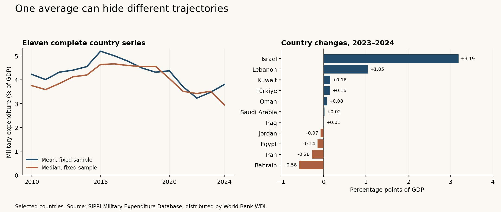

<div dir="rtl" lang="ar">

# ما الذي يخفيه المتوسط الإقليمي؟

## العبء العسكري في دول مختارة من الشرق الأوسط، ٢٠١٠–٢٠٢٤

مشروع في الكتابة الأكاديمية والترجمة إلى العربية والتحليل الكمّي. يفحص كيف يتغيّر وصف الإنفاق العسكري عند استخدام المتوسط أو الوسيط، أو عند تغيير الفترة الزمنية والدول الداخلة في الحساب.

تُظهر بيانات الدول الإحدى عشرة ذات السلاسل المكتملة أن المتوسط ارتفع بين عامَي ٢٠٢٣ و٢٠٢٤، بينما انخفض الوسيط. وعند استبعاد إسرائيل، تنخفض الزيادة في المتوسط من ٠٫٣٢٧ إلى ٠٫٠٤١ نقطة مئوية. أمّا خلال الفترة ٢٠١٠–٢٠٢٤، فيحافظ متوسط التغيّر على اتجاه سالب عند استبعاد كل دولة على حدة.

يتضمّن المستودع الورقة العربية الكاملة والنص الإنجليزي الذي تُرجمت عنه، إضافةً إلى مسرد للمصطلحات وشفرة قابلة لإعادة الإنتاج وجداول وشكلين. ويعرض جدول التغطية القيم المفقودة في السلسلة السورية، ويوضّح سبب اعتماد مجموعة ثابتة من الدول في المقارنة.

</div>

[اقرأ الورقة بالعربية](research-note-ar.md) · [English source text](research-note-en.md) · [مسرد الترجمة](translation-glossary.md) · [Sources and definitions](SOURCES.md)



## Research question

How much does the description of a regional military-spending trend depend on the summary statistic, time horizon and membership of the country group?

The project uses SIPRI military-expenditure data distributed by World Bank WDI. It requests twelve selected Middle Eastern states during 2010–2024, retains 180 country-year records, and uses the eleven complete country series for comparisons over time. It calculates mean and median trends, changes within countries, and sensitivity to omitting each country in turn.

The original English paper has a full Arabic translation. The glossary explains choices involving balanced panels, missing data, percentage points, confidence intervals and the distinction between a change in the median and the median of changes.

## Reproduce

Requires Python 3.11 or later.

```bash
python -m pip install -r requirements.txt
python analysis.py
```

The script uses the bundled API snapshot, verifies its checksum and regenerates all tables and figures without a network request. To write results elsewhere, run `python analysis.py --output-dir /path/to/output`.

| Material | File |
| --- | --- |
| Full Arabic paper | [research-note-ar.md](research-note-ar.md) |
| English source paper | [research-note-en.md](research-note-en.md) |
| Statistical translation choices | [translation-glossary.md](translation-glossary.md) |
| Source definitions and data rights | [SOURCES.md](SOURCES.md) |
| Analysis code | [analysis.py](analysis.py) |
| Full panel, including missing values | [country-year-panel.csv](country-year-panel.csv) |
| Coverage by country | [data-coverage.csv](data-coverage.csv) |
| Annual summary statistics | [annual-summary.csv](annual-summary.csv) |
| Country changes | [country-changes.csv](country-changes.csv) |
| Single-country omission results | [leave-one-country-out.csv](leave-one-country-out.csv) |
| Machine-readable findings | [results.json](results.json) |

Prepared for **Hekmat Matthew Aboukhater’s portfolio**, with AI assistance in preparation, coding and translation. The analysis uses a fixed 2010–2024 historical window. SIPRI retains its data rights and its terms apply to the bundled extract. See [SOURCES.md](SOURCES.md) and [LICENSE.md](LICENSE.md).
