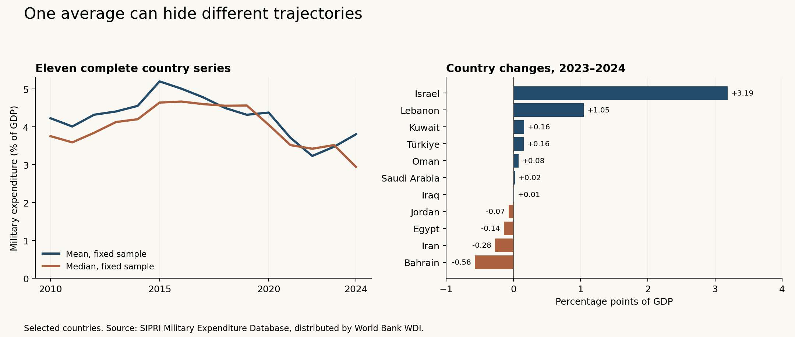
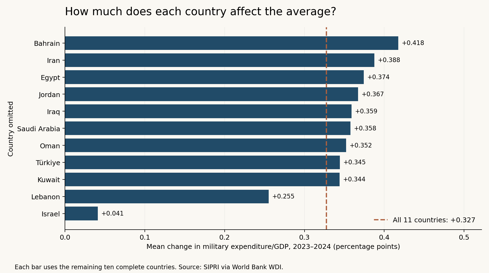

# ما الذي يخفيه المتوسط الإقليمي؟

## العبء العسكري في دول مختارة من الشرق الأوسط، ٢٠١٠–٢٠٢٤

ترجمة عربية للنص الإنجليزي المُعدّ لهذا المشروع ضمن ملف أعمال حكمت ماثيو أبو خاطر. استُخدمت مساعدة الذكاء الاصطناعي في إعداد النص وترجمته وكتابة الشفرة.

### الملخّص

تبحث هذه الورقة في أثر التجميع الإحصائي في تفسير الإنفاق العسكري نسبةً إلى الناتج المحلي الإجمالي. وتعتمد مقتطفًا تاريخيًا ثابتًا من بيانات معهد ستوكهولم الدولي لأبحاث السلام، التي يتيحها البنك الدولي عبر مؤشرات التنمية العالمية، لاثنتي عشرة دولة مختارة من الشرق الأوسط خلال الفترة ٢٠١٠–٢٠٢٤. وتتوفر لإحدى عشرة منها سلاسل سنوية مكتملة. وفي هذه المجموعة المتوازنة، ارتفع المتوسط من ٣٫٤٧٧٪ من الناتج عام ٢٠٢٣ إلى ٣٫٨٠٤٪ عام ٢٠٢٤، بينما انخفض الوسيط بين الدول من ٣٫٥٢١٪ إلى ٢٫٩٤٥٪. ويؤدّي استبعاد إسرائيل إلى خفض الزيادة في المتوسط من ٠٫٣٢٧ إلى ٠٫٠٤١ نقطة مئوية. أمّا بين عامَي ٢٠١٠ و٢٠٢٤، فانخفض المتوسط بمقدار ٠٫٤٢٦ نقطة مئوية، واستمرّ اتجاه الانخفاض عند استبعاد كل دولة على حدة. وتبيّن النتائج كيف يؤثّر الأفق الزمني وتغطية الدول واختيار المقياس في وصف المسار الإقليمي.

### سؤال البحث ونطاق المقارنة

تختزل أوصاف الإنفاق العسكري الإقليمي مساراتٍ وطنية متعددة في رقم واحد. وقد يتزامن ارتفاع المتوسط مع انخفاض العبء العسكري في عدة دول، أو مع انخفاض الوسيط. ولكل حالة دلالتها عند الحديث عن سلوك مشترك على مستوى المنطقة. ويتعلّق سؤال القياس بمدى تعبير التغيّر الإجمالي عن تحوّل واسع بين الدول، أو عن تغيّرات كبيرة تقتصر على جزء من المجموعة.

تشمل مجموعة الدول المطلوبة البحرين ومصر وإيران والعراق وإسرائيل والأردن والكويت ولبنان وعُمان والسعودية وسوريا وتركيا. وهي مجموعة مختارة للمقارنة. ويتطلّب تعميم النتيجة على الشرق الأوسط بأكمله تحديدًا مستقلًا لعضوية المنطقة وفحصًا أوسع لتغطية البيانات. وتعتمد الورقة الفترة ٢٠١٠–٢٠٢٤ نافذةً زمنية ثابتة، بحيث يشير النص الإنجليزي وترجمته العربية إلى المشاهدات نفسها.

### البيانات والتغطية

المتغيّر المستخدم هو الإنفاق العسكري كنسبة مئوية من الناتج المحلي الإجمالي. ويقدّم معهد ستوكهولم السلسلة الأصلية، بينما يتيحها البنك الدولي. وتُرفَق بالشفرة استجابة محفوظة من واجهة البيانات، مع وقت التنزيل وبصمة رقمية للتحقّق من سلامة الملف. وتضمّ الاستجابة ١٨٠ سجلًا لدولة في سنة معيّنة، منها ١٦٦ قيمة متاحة وأربع عشرة قيمة مفقودة.

تخصّ جميع القيم المفقودة سوريا بين عامَي ٢٠١١ و٢٠٢٤. وتبقى قيمتها المتاحة لعام ٢٠١٠ ظاهرةً في جدول التغطية وملف البيانات الأصلي. أمّا المجموعة المتوازنة فتتكوّن من الدول الإحدى عشرة التي تتوافر لها مشاهدات في كل سنة، بإجمالي ١٦٥ مشاهدة قابلة للتحليل. ويمنع تثبيت العضوية تغيّر المقارنة السنوية لمجرّد دخول دولة إلى الحساب أو خروجها منه. وتعرض الشفرة أيضًا المتوسط المحسوب باستخدام جميع القيم المتاحة في كل سنة، مع عدد الدول الداخلة فيه، كي يتمكّن القارئ من فحص قرار التغطية.

### المقاييس وفحص الحساسية

يرمز b_ct إلى الإنفاق العسكري في الدولة c خلال السنة t مقسومًا على ناتجها المحلي الإجمالي ومضروبًا بمئة. وتُقاس قيمته بوحدات النسبة المئوية من الناتج. ولمجموعة ثابتة تضمّ N دولة، يُحسب المتوسط السنوي بجمع نسب الدول وقسمتها على عددها.

$$\bar b_t=\frac{1}{N}\sum_{c\in S}b_{ct}$$

تحصل كل دولة على الوزن نفسه. أمّا الوسيط فهو القيمة الواقعة في منتصف التوزيع بعد ترتيب نسب الدول. ويساوي التغيّر في المتوسط بين سنتين متوسط الفروق داخل الدول نفسها.

$$\Delta\bar b=\frac{1}{N}\sum_{c\in S}(b_{c,t_1}-b_{c,t_0})$$

ولفحص اعتماد النتيجة على حالات منفردة، تُستبعَد كل دولة بالتتابع، ثم يُعاد حساب متوسط التغيّر للدول المتبقّية.

$$\Delta\bar b_{(-k)}=\frac{1}{N-1}\sum_{c\in S,\ c\ne k}(b_{c,t_1}-b_{c,t_0})$$

يقيس هذا الإجراء حساسية الملخّص لتغيّر العضوية بدولة واحدة. وتُقرأ نتائجه بوصفها فحصًا للحساسية، ولا تمثّل فواصل ثقة. وتُطبَّق العملية نفسها على الفترتين ٢٠٢٣–٢٠٢٤ و٢٠١٠–٢٠٢٤، مع عرض التغيّر داخل كل دولة في كلتا الفترتين.

### نتائج الأجل القصير

ارتفع متوسط المجموعة المتوازنة بمقدار ٠٫٣٢٧ نقطة مئوية بين عامَي ٢٠٢٣ و٢٠٢٤، من ٣٫٤٧٧٪ إلى ٣٫٨٠٤٪. وانخفض الوسيط خلال الفترة نفسها بمقدار ٠٫٥٧٦ نقطة مئوية. وسجّلت سبع دول زيادات، بينما سجّلت أربع دول انخفاضات. ويعكس اختلاف اتجاه المتوسط والوسيط اختلاف استجابة كل منهما لتوزيع القيم بين الدول.

ارتفع العبء العسكري في إسرائيل بمقدار ٣٫١٨٩ نقطة مئوية، وهي أكبر زيادة على مستوى دولة منفردة في هذه المجموعة. وعند استبعادها، تنخفض الزيادة في متوسط الدول المتبقّية إلى ٠٫٠٤١ نقطة مئوية. وتبقى إشارة التغيّر موجبةً عند استبعاد كل دولة على حدة، لكن حجم التغيّر يتراوح بين ٠٫٠٤١ و٠٫٤١٨ نقطة مئوية. وهكذا يستمرّ اتجاه الزيادة في هذا الفحص، بينما يعتمد حجمها بدرجة كبيرة على حالات معيّنة.

ويبلغ وسيط التغيّرات داخل الدول موجب ٠٫٠٢٤ نقطة مئوية، وهو مقياس يختلف عن التغيّر في الوسيط بين الدول، البالغ سالب ٠٫٥٧٦. فالعملية الأولى ترتّب مقدار التغيّر في كل دولة، بينما تقارن الثانية القيمة الوسطى بين الدول في كل سنة. وقد تتبدّل مواقع الدول داخل التوزيع، لذلك يمكن أن تنتج العمليتان قيمًا واتجاهات مختلفة.

### الأفق الزمني الأطول

بين عامَي ٢٠١٠ و٢٠٢٤، انخفض متوسط المجموعة الثابتة من ٤٫٢٣٠٪ إلى ٣٫٨٠٤٪ من الناتج المحلي الإجمالي، أي بمقدار ٠٫٤٢٦ نقطة مئوية. وكانت إسرائيل والكويت الدولتين الوحيدتين اللتين سجّلتا زيادة بين نقطتَي البداية والنهاية. ويحافظ متوسط التغيّر على إشارة سالبة عند استبعاد كل دولة بالتتابع، وتتراوح القيم الناتجة بين سالب ٠٫٧٤٤ وسالب ٠٫٢٥٢ نقطة مئوية.

تصف الزيادة القصيرة الأجل والانخفاض الأطول أجلًا فترتين مختلفتين. ولهذا تتطلّب المقارنة تحديد التواريخ إلى جانب تحديد المقياس. فالحديث عن زيادة في السنة الأخيرة وحدها لا يكفي لاستنتاج اتجاه المسار خلال السنوات الخمس عشرة بكاملها.

### التفسير وحدود التحليل

يصف المتوسط الحسابي متوسط نسب الدول في المجموعة المختارة. أمّا حساب مجموع الإنفاق العسكري مقسومًا على مجموع الناتج الإقليمي فيتطلّب أوزانًا مرتبطةً بالناتج وتعريفًا متّسقًا لعضوية المنطقة. وفي الحساب المستخدم هنا، يحصل الاقتصاد الصغير والاقتصاد الكبير على وزن متساوٍ.

وقد تتغيّر نسبة الإنفاق العسكري إلى الناتج بسبب تغيّر الإنفاق في البسط أو الناتج في المقام أو كليهما. ويتطلّب فصل هذه الآليات سلاسل إضافية. ويوثّق معهد ستوكهولم أيضًا اختلافات في نطاق التقارير الوطنية ومراجعات البيانات عبر الزمن. ولا يحتفظ مقتطف البنك الدولي بجميع الملاحظات الخاصة بكل دولة في ملف المعهد الأصلي، لذا ينبغي الرجوع إليها عند إجراء مقارنات تفصيلية للموازنات.

وأخيرًا، يترك اختيار السلاسل المكتملة سوريا خارج الاتجاه الإجمالي، كما أن المجموعة المختارة لا تشمل جميع دول الشرق الأوسط. وتقيس سجلات الإنفاق الموارد المخصّصة للأنشطة العسكرية، بينما يتطلّب تقييم القدرة العسكرية أو نجاح السياسات أو الأثر السببي للنزاع أدلةً إضافية وتصميمًا بحثيًا ملائمًا.

### إعادة إنتاج النتائج

تُثبَّت المكتبات المحدّدة في ملف المتطلّبات، ثم تُشغَّل شفرة التحليل المرفقة. ويتحقّق التنفيذ الافتراضي من سلامة نسخة المصدر، ويحتفظ بالقيم المفقودة، ثم يعيد إنشاء خمسة جداول وملخّص للنتائج وشكلين. وتشرح وثائق المصدر التغطيةَ والإسناد، بينما يسجّل مسرد الترجمة الفروق الإحصائية التي جرى الحفاظ عليها في العربية.

[English source text](research-note-en.md) · [المصادر](SOURCES.md) · [مسرد الترجمة](translation-glossary.md) · [شفرة التحليل](analysis.py)
