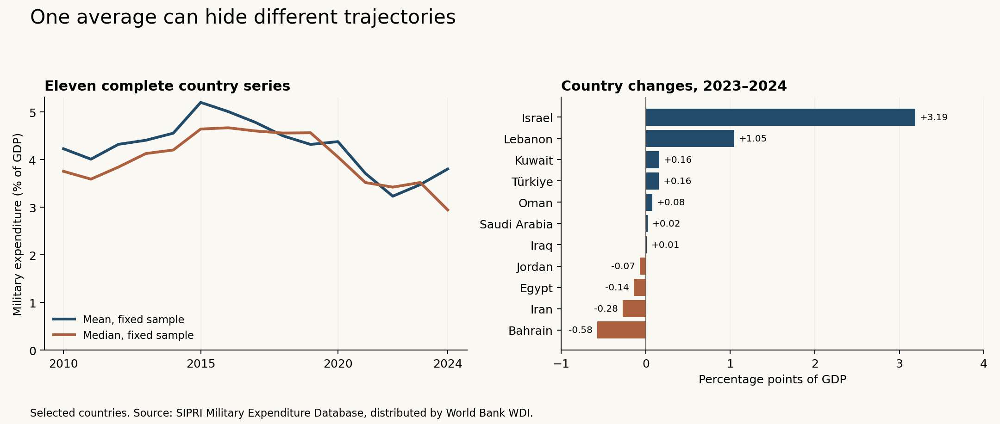
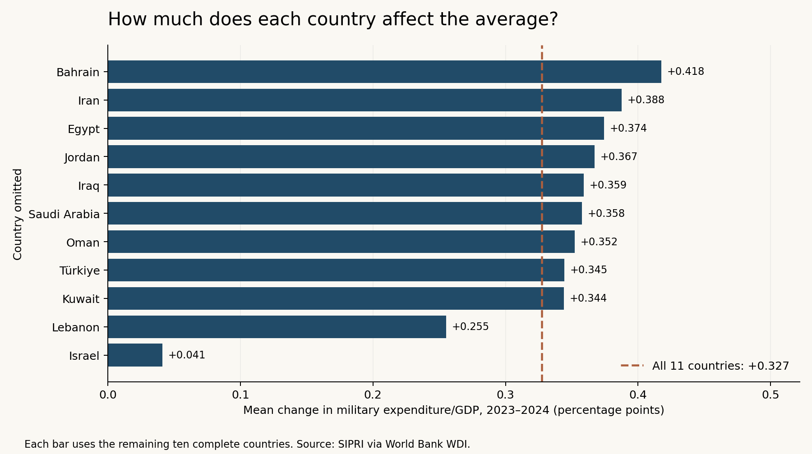

# What does a regional average conceal?

## Military burden in selected Middle Eastern states, 2010–2024

English source text for the [Arabic translation](research-note-ar.md). Prepared for Hekmat Matthew Aboukhater’s research portfolio with AI assistance in preparation, translation and coding.

### Abstract

This note examines how aggregation changes the interpretation of military expenditure as a share of GDP. It draws a fixed historical extract from SIPRI’s military-expenditure data, distributed through World Bank World Development Indicators, for twelve selected Middle Eastern states during 2010–2024. Eleven have complete annual series. In this balanced sample, the mean rose from 3.477% of GDP in 2023 to 3.804% in 2024, while the cross-country median fell from 3.521% to 2.945%. Omitting Israel reduces the mean increase from 0.327 to 0.041 percentage points. Across the longer 2010–2024 period, the mean fell by 0.426 percentage points, with a decline under every single-country omission. The findings show how time horizons, country coverage and summary statistics shape descriptions of a regional trajectory.

### Question and scope

Descriptions of regional military spending often compress many national trajectories into one number. A higher average can coexist with declining burdens in several countries or a lower median. These outcomes carry different implications for claims about shared regional behaviour. The measurement question is whether an aggregate change characterises a broad shift across countries or large movements within part of the sample.

The requested group contains Bahrain, Egypt, Iran, Iraq, Israel, Jordan, Kuwait, Lebanon, Oman, Saudi Arabia, Syria and Türkiye. It is a selected comparison group. A claim about the entire Middle East would require a separate definition of regional membership and a wider coverage assessment. The analysis uses a fixed 2010–2024 window so that the source text and its Arabic translation refer to the same observations.

### Data and coverage

The indicator is `MS.MIL.XPND.GD.ZS`, military expenditure as a percentage of GDP. SIPRI supplies the underlying series and the World Bank distributes it. A frozen API response, retrieval timestamp and SHA-256 checksum accompany the code. The response contains 180 country-year records, with 166 observed values and fourteen missing values.

Every missing value belongs to Syria, for 2011–2024. Syria’s reported 2010 value remains in the coverage table and source panel. The balanced sample comprises the eleven countries observed in every year, yielding 165 usable observations. This fixed membership keeps annual comparisons from changing simply because a country enters or leaves the calculation. The code also reports the available-case mean and its country count, making the coverage decision inspectable.

### Measures and sensitivity

Let b_ct denote military expenditure divided by GDP, multiplied by one hundred. It is reported as a percentage of GDP, and differences between its values are measured in percentage points. For a fixed set S of N countries, the annual arithmetic mean is

$$\bar b_t=\frac{1}{N}\sum_{c\in S}b_{ct}.$$

Each country receives equal weight. The median describes the middle country value in the sorted distribution. The change in the mean over a chosen interval is

$$\Delta\bar b=\frac{1}{N}\sum_{c\in S}(b_{c,t_1}-b_{c,t_0}).$$

To examine dependence on individual cases, the analysis omits each country k and recalculates

$$\Delta\bar b_{(-k)}=\frac{1}{N-1}\sum_{c\in S,\ c\ne k}(b_{c,t_1}-b_{c,t_0}).$$

These leave-one-country-out calculations are sensitivity checks. They show how much the summary changes when membership changes by one country. They are not confidence intervals. The script applies the same procedure to 2023–2024 and 2010–2024, and reports country-level changes for both intervals.

### Short-run findings

The balanced-sample mean rose by 0.327 percentage points between 2023 and 2024, from 3.477% to 3.804%. Over the same interval, the median fell by 0.576 percentage points. Seven countries recorded increases, while four recorded declines. The different directions of the mean and median reflect their different responses to the distribution of country values.

Israel’s burden increased by 3.189 percentage points, the largest country-level increase in this sample. Omitting Israel brings the mean increase down to 0.041 percentage points. The sign remains positive under every single-country omission, but the magnitude ranges from 0.041 to 0.418 percentage points. Thus the positive mean change is stable to these omissions, while its size depends strongly on particular cases.

The median of country-level changes is +0.024 percentage points. That differs from the change in the cross-country median, which is −0.576. The first statistic sorts each country’s change. The second compares the middle country value in each year. Countries can change their positions in the distribution, so these operations need not produce the same result.

### The longer horizon

Between 2010 and 2024, the fixed-sample mean declined from 4.230% to 3.804% of GDP, a change of −0.426 percentage points. Only Israel and Kuwait recorded endpoint increases. Removing one country at a time preserves a negative mean change in every case, with estimates ranging from −0.744 to −0.252 percentage points.

The short-run increase and longer-run decline describe different intervals. The comparison therefore requires the dates as well as the statistic. A statement about an increase in the latest year cannot establish the direction of the entire fifteen-year trajectory.

### Interpretation and limits

The arithmetic mean describes the average country ratio in this selected sample. Calculating total military expenditure divided by total regional GDP would require GDP weights and a consistent membership definition. Here, a small economy and a large economy each receive one vote in the average.

A military-expenditure-to-GDP ratio can change through the expenditure numerator, the GDP denominator or both. Separating these mechanisms requires additional series. SIPRI also documents differences in national reporting coverage and revisions over time. The World Bank extract does not preserve every country-specific annotation from the original SIPRI workbook. Detailed budget comparisons should consult those notes.

Finally, complete-case selection leaves Syria outside the aggregate trend, and the chosen group omits other Middle Eastern states. Expenditure records also measure resource inputs. Assessing military capability, policy success or the causal effect of conflict requires additional evidence and an appropriate research design.

### Reproduction

Run `python -m pip install -r requirements.txt`, followed by `python analysis.py`. The default analysis checks the saved source file, retains missing values and regenerates five CSV tables, a JSON results summary and two figures. The [source documentation](SOURCES.md) explains coverage and attribution. The [translation glossary](translation-glossary.md) records the statistical distinctions preserved in Arabic.
